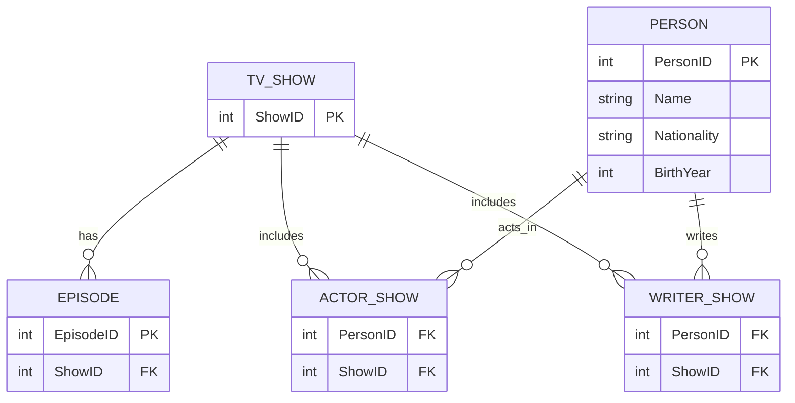

# TV Show Database Design

Converted from the hand-drawn sketch.

- The same person can be both an actor and a writer on a show, so there's one `PERSON` table instead of separate `ACTOR` and `WRITER` tables.
- `ACTOR_SHOW` and `WRITER_SHOW` are junction tables that both point to `PERSON` and `TV_SHOW` — a person can have a row in either, or both, for the same show.
- `EPISODE` belongs to exactly one `TV_SHOW` (one show has many episodes).

