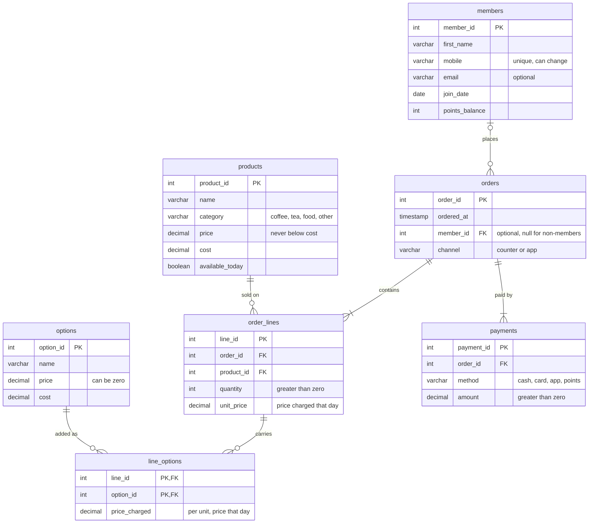

# Babson Bean Café Database

## 1. The Scenario

Scenario C: Babson Bean Café. Babson Bean is an on-campus café whose till records sales, but its loyalty punch cards can't answer questions. This database tracks loyalty members, the menu, add-on options, orders, order lines, the options on each line, and payments, so the café can see what sells, which add-ons earn their keep, and who its regular customers are.

## 2. The ERD

## 3. What One Row Means

- `members`: One person who joined the loyalty program
- `products`: One item on the menu, like a latte or a muffin 
- `options`: One add-on the café offers, like oat milk or an extra shot, with its price and cost
- `orders`: One purchase at one moment, by a member or a non-member
- `order_lines`: One product within one order
- `line_options`: One add-on applied to one line, e.g. oat milk on that 2-latte line
- `payments`: One payment toward one order, an amount paid by one method

## 4. Design Choices

